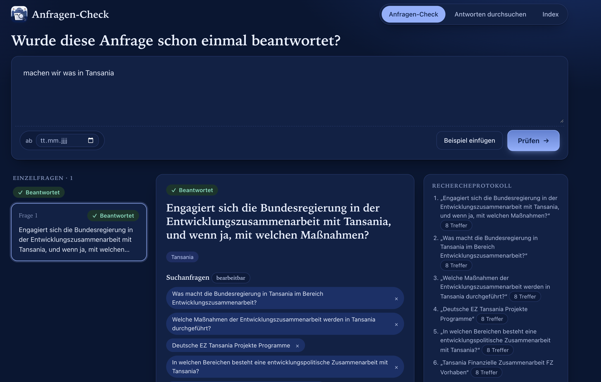
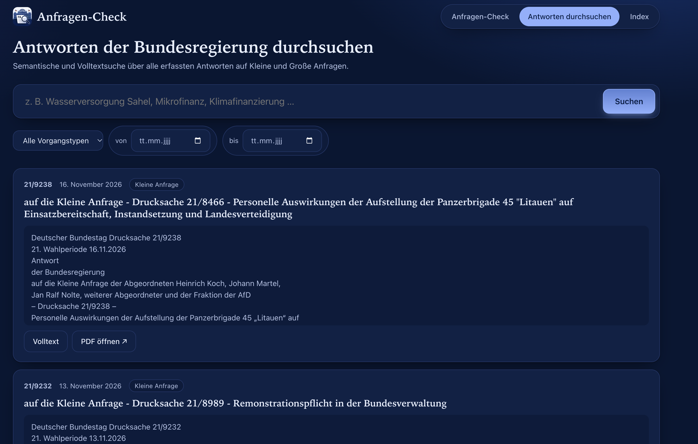
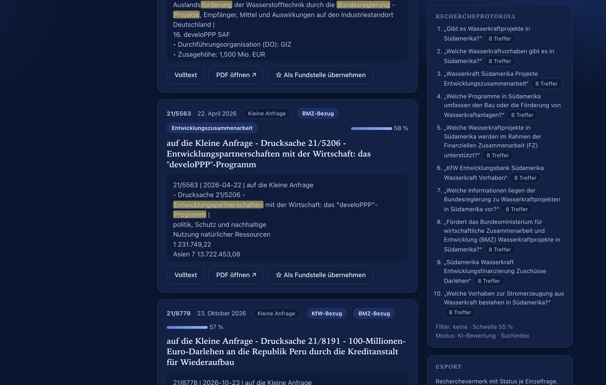

# Anfragen-Check

**Wurde diese parlamentarische Anfrage schon einmal beantwortet?**

Anfragen-Check durchsucht die Antworten der Bundesregierung auf Kleine und Große Anfragen des Deutschen Bundestags (Fokus: KfW Entwicklungsbank / BMZ) und beantwortet die Frage mit **wörtlichem Zitat, Datum und PDF-Link** – oder sagt ehrlich, dass nichts gefunden wurde.

- **Anfragen-Check:** Eine ganze Anfrage, eine Einzelfrage oder nur Stichworte einfügen. Die App zerlegt sie in Einzelfragen, sucht je Frage mit mehreren Suchvarianten und bewertet: *beantwortet*, *teilweise* oder *nichts gefunden*.
- **Antworten durchsuchen:** Semantische Suche plus Stichwortsuche mit Filtern (Vorgangstyp, Zeitraum). Jede Antwort trägt konfigurierbare **Tags** (z. B. „KfW-Bezug“, „BMZ-Bezug“).
- **Index-Status:** Zeigt, was im Suchindex liegt und ob alles zu Ihren eigenen Dokumenten passt.
- **Recherchevermerk:** Export je Prüfung mit Status, Zitaten und gewählten Fundstellen.


*Anfragen-Check: Die Frage wird in Suchvarianten übersetzt, das Ergebnis mit Status, Entitäten und Rechercheprotokoll gezeigt.*

**Technik:** Next.js 15 (App Router, TypeScript) · Azure (Foundry) für Embeddings (`text-embedding-3-large`, 1536 Dimensionen) und das Chat-Modell (GPT-6 Astra) · **keine Datenbank**: PDFs, Metadaten und der Suchindex liegen als Dateien im Ordner `data/` (nicht im Git).

---

## Inhalt

1. [Schnellstart](#schnellstart)
2. [Einrichtung](#einrichtung)
3. [Daten laden und Index bauen](#daten-laden-und-index-bauen)
4. [Neue Dokumente hinzufügen](#neue-dokumente-hinzufügen)
5. [Die App benutzen](#die-app-benutzen)
6. [So funktioniert es](#so-funktioniert-es)
7. [Tags konfigurieren](#tags-konfigurieren)
8. [Nutzungsprotokoll](#nutzungsprotokoll)
9. [Kosten und Laufzeit](#kosten-und-laufzeit)
10. [Fehlerbehebung](#fehlerbehebung)
11. [Projektstruktur](#projektstruktur)
12. [Grenzen und offene Punkte](#grenzen-und-offene-punkte)

---

## Schnellstart

**Voraussetzungen:** Node.js 20.6 oder neuer, ein Azure-(Foundry-)Zugang mit einem Embedding-Deployment (und optional einem Chat-Deployment) sowie ein Schlüssel für die DIP-API des Bundestags.

### Variante A – nur ansehen (Demo-Modus, ohne Konto)

```bash
git clone https://github.com/jzakotnik/parlanext.git
cd parlanext
npm install
npm run dev
```

Öffnen Sie <http://localhost:3000>. Ohne Index erscheint ein Hinweis „Demo-Modus“, und die App zeigt sechs **fiktive** Beispielantworten. Ohne Azure-Schlüssel bewertet sie nur heuristisch (nie „beantwortet“).

### Variante B – mit echten Daten

```bash
npm install
cp .env.example .env.local          # 1. Zugangsdaten eintragen (siehe unten)
npm run fetch -- --monate 1 --limit 20   # 2. kleiner Download zum Testen
npm run ingest -- --limit 20             # 3. kleiner Index zum Testen
npm run dev                              # 4. App starten
```

Prüfen Sie dann unter **Index** (`/index-status`), ob alles stimmt. Danach laden Sie den gewünschten Zeitraum komplett (`npm run fetch -- --monate 12`) und bauen den vollständigen Index (`npm run ingest`).

---

## Einrichtung

Kopieren Sie `.env.example` nach `.env.local` und tragen Sie die Werte ein. Die Datei steht in `.gitignore`, Schlüssel gelangen nie ins Repository und nie in den Browser.

| Variable | Bedeutung |
|---|---|
| `AZURE_OPENAI_ENDPOINT` | Endpunkt Ihrer Azure-Resource **mit** `/openai/v1` am Ende, z. B. `https://<resource>.services.ai.azure.com/openai/v1` |
| `AZURE_OPENAI_API_KEY` | Schlüssel der Resource (Foundry-Portal → Keys und Endpoint) |
| `AZURE_EMBEDDING_DEPLOYMENT` | **Name** Ihres Embedding-Deployments (nicht der Modellname), z. B. `text-embedding-3-large` |
| `AZURE_CHAT_DEPLOYMENT` | Name Ihres Chat-Deployments (GPT-6 Astra). Ohne ihn bewertet die App nur heuristisch |
| `EMBEDDING_DIMENSIONS` | Standard `1536`. Muss beim Indexieren und Suchen gleich sein |
| `DATA_DIR` | Datenordner, Standard `./data` |
| `DIP_API_KEY` | Schlüssel für die DIP-API: dip.bundestag.de → *Über DIP* → *Hilfe* → *API* |

Optionale Einstellungen:

| Variable | Bedeutung |
|---|---|
| `INDEX_TYPEN` | Welche Drucksachentypen indexiert werden. Standard `Antwort`. Beispiel: `Antwort,Kleine Anfrage` |
| `EMBED_BATCH` | Texte pro Embedding-Anfrage, Standard `32` (bei hoher Quota z. B. `64`, bei knapper `16`) |
| `CHECK_PRO_SUCHE` | Treffer je Suchanfrage im Anfragen-Check, Standard `20` |
| `CHECK_MAX_TREFFER` | Fundstellen je Einzelfrage insgesamt, Standard `50` |
| `CHECK_ANZEIGE` | Zuerst angezeigte Fundstellen und Schrittweite von „Weitere anzeigen“, Standard `20` |
| `CHECK_BEWERTET` | So viele Treffer bewertet GPT (mehr = mehr Token), Standard `6` |
| `SUCHE_MAX` | Maximum auf „Antworten durchsuchen“ (Schaltfläche „Mehr laden“ in 20er-Schritten), Standard `100` |
| `EMBED_TIMEOUT_MS` | Zeitlimit je Embedding-Aufruf, Standard `120000` (2 min); bei Überschreitung wird der Batch geteilt und wiederholt |
| `EMBED_MAX_TOKENS` | Geschätzte Obergrenze je Anfrage, Standard `100000` (Azure-Limit: 300.000) |

**Verbindung prüfen** (sollte JSON mit einem `embedding`-Array zurückgeben):

```bash
set -a; source .env.local; set +a
curl -s "$AZURE_OPENAI_ENDPOINT/embeddings" \
  -H "api-key: $AZURE_OPENAI_API_KEY" -H "Content-Type: application/json" \
  -d "{\"model\":\"$AZURE_EMBEDDING_DEPLOYMENT\",\"input\":\"Test\",\"dimensions\":1536}" | head -c 300
```

---

## Daten laden und Index bauen

Alles liegt im Ordner `data/` (wird von den Werkzeugen selbst angelegt, `npm run data:init` legt ihn auch ohne Download an):

```
data/
├── kleine_anfragen/
│   ├── metadaten.jsonl      ← eine Zeile je Drucksache (Anfragen UND Antworten)
│   ├── 291982.pdf           ← Dateiname = Feld "id" der Zeile
│   └── …
├── grosse_anfragen/
│   ├── metadaten.jsonl
│   └── …
└── index/                   ← wird von „ingest“ erzeugt
    ├── texts/<id>.txt       ← extrahierter Volltext
    ├── chunks.jsonl         ← Textabschnitte
    ├── vectors.f32          ← Embedding-Vektoren
    ├── tags.json            ← Tags je Dokument (aus dem Volltext, siehe config/tags.json)
    └── manifest.json        ← Modell, Dimension, indexierte Dokumente
```

### Schritt 1: Download vom Bundestag (`npm run fetch`)

Lädt Kleine und Große Anfragen einer Wahlperiode **und** die zugehörigen Antworten der Bundesregierung (PDF + Metadaten) direkt in `data/`.

```bash
npm run fetch -- --monate 12        # letzte 12 Monate
npm run fetch -- --von 2025-03-25   # ab einem Datum
npm run fetch                       # komplette Wahlperiode 21
```

| Option | Bedeutung |
|---|---|
| `--monate N` | Zeitraum: die letzten N Monate |
| `--von JJJJ-MM-TT`, `--bis JJJJ-MM-TT` | Zeitraum nach Datum der Drucksache |
| `--wahlperiode N` | Wahlperiode, Standard `21` |
| `--limit N` | Nur N Drucksachen laden (zum Testen!) |
| `--nur anfragen` / `--nur antworten` | Nur eine der beiden Phasen ausführen |
| `--pause MS` | Mittlere Pause zwischen Abrufen, Standard `400` (zufällig 0,5×–1,5×) |
| `--antwort-typ NAME` | Falls DIP den Typ „Antwort“ anders benennt |

Eigenschaften:

- **Sequentiell und höflich:** keine parallelen Abrufe, zufällige Pausen, ehrlicher User-Agent. Bei der Browser-Prüfung des Servers („Bot-Schutz“) wartet das Tool und bricht nach vier Versuchen ab. Die Prüfung wird nicht umgangen.
- **Wiederholbar:** Vorhandenes wird übersprungen, ein Abbruch kostet nichts. Erst `--monate 1`, später `--monate 12` ist problemlos möglich.
- **404 bei PDFs:** Ganz neue Drucksachen sind beim Bundestag oft noch nicht abrufbar. Sie werden übersprungen und beim nächsten Lauf erneut versucht.
- **Dauer:** rund 4.000 PDFs für 12 Monate brauchen gut eine Stunde.

### Schritt 2: Index bauen (`npm run ingest`)

Liest die PDFs, extrahiert den Text, zerlegt ihn in Abschnitte (je Frage-Antwort-Paar), holt die Embeddings von Azure und speichert alles in `data/index/`.

```bash
npm run ingest -- --limit 50   # erst klein testen
npm run ingest                 # dann alles
```

- **Chunking** (`src/lib/chunker.ts`): je Einzelfrage mit Antwort ein Abschnitt. Gemeinsam beantwortete Fragen („Die Fragen 1 und 2 werden gemeinsam beantwortet“) und Unterfragen a), b) bleiben zusammen, Vorbemerkungen sind eigene Abschnitte, Seitenköpfe und Druckvermerk entfallen. Lange Antworten werden mit Überlappung geteilt (`CHUNK_MAX_CHARS`, Standard 8000), die Frage steht in jedem Teil. Nach dieser Änderung `data/index` löschen und neu indexieren.
- Es werden **nur Drucksachen vom Typ „Antwort“** indexiert (`INDEX_TYPEN` ändert das). Die Anfragen selbst bleiben unindexiert.
- **Wiederholbar:** Bereits indexierte Dokumente werden übersprungen. Nach einem Abbruch macht der Lauf dort weiter.
- **Rate-Limits:** Bei HTTP 429 wartet das Tool selbst (Retry-After, adaptive Drosselung).
- **Tags** (z. B. „KfW-Bezug“) werden beim Ingest aus dem Volltext abgeleitet, Konfiguration siehe [Tags konfigurieren](#tags-konfigurieren).
- Ein Modell- oder Dimensionswechsel erfordert einen neuen Index (`data/index` löschen). Das Tool verweigert sonst das Weiterschreiben.

---

## Neue Dokumente hinzufügen

### Weg 1: Neue Drucksachen automatisch nachladen (empfohlen)

Regelmäßig, z. B. wöchentlich:

```bash
npm run fetch -- --monate 1    # holt alles Neue der letzten Zeit, Bekanntes wird übersprungen
npm run ingest                 # indexiert nur die neuen Antworten
```

Nach dem Ingest ist alles sofort durchsuchbar (die App erkennt den neuen Index ohne Neustart). Möchten Sie **mehr Zeitraum** abdecken, erhöhen Sie `--monate` (z. B. 24) oder setzen `--von` früher. Für ältere Wahlperioden zusätzlich `--wahlperiode 20`.

### Weg 2: Eigene PDFs manuell hinzufügen

1. **PDF ablegen** in `data/kleine_anfragen/` oder `data/grosse_anfragen/`. Der Ordner bestimmt den Vorgangstyp.
2. **Eine Zeile an `metadaten.jsonl` anhängen** (eine Zeile, gültiges JSON). Mindestens:

   ```json
   {"id":"12345","drucksachetyp":"Antwort","dokumentnummer":"21/9999","datum":"2026-11-01","titel":"Titel der Antwort"}
   ```

   Die PDF muss `12345.pdf` heißen (Dateiname = `id`). Alternativ geben Sie den Dateinamen mit `"datei":"meine-datei.pdf"` an.

   Weitere sinnvolle Felder:

   | Feld | Bedeutung |
   |---|---|
   | `drucksachetyp` | **Muss `"Antwort"` sein** (oder zu `INDEX_TYPEN` passen), sonst wird die Zeile nicht indexiert |
   | `dokumentnummer` | Anzeige, z. B. `21/9999` |
   | `datum` | `JJJJ-MM-TT`, für Filter und die „älter als 12 Monate“-Markierung |
   | `titel` | Anzeige und Kontext für die Suche |
   | `deskriptoren`, `sachgebiete` | Listen, verbessern die Suche |
   | `fundstelle.pdf_url` | Link zum Original beim Bundestag |
   | `kfw`, `bmz` | Optional. Fehlen sie, werden sie aus dem Text abgeleitet |

3. **Indexieren:**

   ```bash
   npm run ingest
   ```

   Danach prüfen Sie unter `/index-status`, dass das Dokument indexiert und die PDF vorhanden ist.

### Wichtig zu wissen

- **Bestehende Metadaten werden nicht aktualisiert.** Der Download hängt nur neue Zeilen an. Ändert der Bundestag später Metadaten, bleibt Ihre Zeile auf dem alten Stand.
- **Ein einzelnes Dokument neu indexieren** wird nicht direkt unterstützt. Soll sich z. B. der Text ändern, löschen Sie `data/index` und bauen den Index neu. Das kostet bei 12 Monaten grob ein paar Dollar Embedding-Kosten (siehe unten).
- **Dokumente entfernen:** Zeile aus `metadaten.jsonl` löschen (die App zeigt sie dann nicht mehr) und für einen sauberen Index `data/index` neu bauen.
- **Gescannte PDFs ohne Textebene** werden übersprungen („leer/Verweis“). Dafür bräuchte es OCR.

---

## Die App benutzen

```bash
npm run dev            # Entwicklung, http://localhost:3000
npm run build && npm start   # Produktionsbetrieb
```

| Seite | Zweck |
|---|---|
| `/` – **Anfragen-Check** | Anfrage oder Stichworte einfügen → **Prüfen**. Links die Einzelfragen mit Status, in der Mitte Suchanfragen (bearbeitbar), Urteil mit Zitat und Fundstellen, rechts Rechercheprotokoll und Export |
| `/stoebern` – **Antworten durchsuchen** | Freie Suche mit Filtern für Vorgangstyp und Zeitraum; die Treffer tragen ihre Tags |
| `/antwort/<id>` | Volltext einer Antwort, Link zur PDF und zum Original beim Bundestag |
| `/index-status` – **Index** | Modell, Dimension, Azure-Host, Chunks, Abgleich mit `metadaten.jsonl` |


*Antworten durchsuchen: Suche über alle indexierten Antworten, filterbar nach Vorgangstyp und Zeitraum, mit Volltext und PDF-Link je Treffer.*

**Live-Ablauf:** Während einer Prüfung zeigt die App neben dem Eingabefeld, was gerade passiert (Anfrage zerlegen, Suchvarianten erzeugen, Index durchsuchen, Treffer bewerten, Zitat verifizieren), samt Zeitstempeln und Warnungen, etwa wenn ein GPT-Aufruf scheitert. Nach der Prüfung verschwindet das Fenster; das bleibende Protokoll steht rechts im Ergebnis. Es zeigt Schritte der App, nicht die internen Gedanken des Modells.

**Wie viele Treffer:** Der Anfragen-Check sammelt je Einzelfrage bis zu 50 Fundstellen (zusammengeführt aus allen Suchvarianten) und zeigt zuerst die besten 20, danach lassen sich weitere in 20er-Schritten oder alle auf einmal einblenden. GPT bewertet davon die besten 6. „Antworten durchsuchen“ zeigt 20 Treffer und lädt mit „Mehr laden“ bis zu 100 nach. Alle Grenzen sind per Umgebungsvariable einstellbar (Tabelle unter Einrichtung).

**Suchanfragen bearbeiten:** Im Ergebnis lassen sich die Suchanfragen einer Einzelfrage mit × entfernen oder über „+ Suchanfrage“ ergänzen. Die erneute Suche startet nicht sofort, sondern nach einem sichtbaren Zähler von 10 Sekunden, den jede weitere Änderung zurücksetzt. So lassen sich mehrere Chips hintereinander löschen. „Jetzt suchen“ startet sofort, „Verwerfen“ nimmt die Änderungen zurück.

**Ergebnis lesen:** Der Status steht immer als Text und Symbol, nie nur als Farbe. Die Erklärung „Modus: KI-Bewertung“ oder „ohne KI“ steht im Rechercheprotokoll. Sehen Sie dort „ohne KI“ oder die Markierung „Heuristik“, obwohl `AZURE_CHAT_DEPLOYMENT` gesetzt ist, ist der Chat-Aufruf fehlgeschlagen (z. B. falscher Deployment-Name oder keine Quota).


*Fundstellen mit Tags („KfW-Bezug“, „BMZ-Bezug“, „Entwicklungszusammenarbeit“), Relevanz in Prozent und hervorgehobenen Suchbegriffen. Rechts das Rechercheprotokoll mit allen zehn Suchvarianten und deren Trefferzahl.*

---

## So funktioniert es

1. **Zerlegen:** GPT zerlegt die Anfrage in Einzelfragen, Entitäten (Länder, Programme, Institutionen, Zeiträume) und **zehn** deutsche Suchvarianten (Fachbegriffe der Entwicklungszusammenarbeit, Synonyme, Abkürzungen, Stichwort- und Oberbegriffsfassungen).
2. **Suchen:** Jede Variante läuft als **Hybridsuche**: Vektorähnlichkeit (Azure-Embeddings) plus Stichwortsuche, zusammengeführt per Reciprocal Rank Fusion, mit den Filtern (KfW, BMZ, Datum, Vorgangstyp). Der Index liegt im Speicher, die Suche braucht keine Datenbank.
3. **Bewerten:** GPT bewertet die besten Treffer pro Einzelfrage.
4. **Belegen:** Ein Urteil gilt nur, wenn das genannte **Zitat wörtlich im Dokument steht**. Lässt es sich nicht verifizieren, wird kein Urteil ausgegeben.

**Vertrauensregeln**

- Urteil nur mit wörtlichem Zitat, Datum und PDF-Link.
- Bei „nichts gefunden“ zeigt die App die verwendeten Suchanfragen und Filter und den nächsten Treffer unter der Relevanzschwelle (0,55).
- Antworten, die älter als 12 Monate sind, werden markiert.
- Ohne Chat-Modell gibt es nur eine Hinweis-Einstufung („teilweise“) und nie „beantwortet“.

---

## Tags konfigurieren

Jede Antwort bekommt **Tags** wie „KfW-Bezug“ oder „BMZ-Bezug“, sichtbar auf den Trefferkarten, der Detailseite und im Index-Status. Welche Tags es gibt, steht in **`config/tags.json`** und lässt sich beliebig erweitern, auch für ganz andere Themen:

```json
{
  "tags": [
    { "id": "kfw", "label": "KfW-Bezug",
      "begriffe": ["KfW", "Kreditanstalt für Wiederaufbau", "Entwicklungsbank"] },
    { "id": "sahel", "label": "Sahel-Region",
      "begriffe": ["Sahel", "Mali", "Niger", "Burkina Faso"] },
    { "id": "ez", "label": "Entwicklungszusammenarbeit",
      "begriffe": ["Entwicklungszusammenarbeit", "Entwicklungspolitik", "ODA"], "mindestens": 2 }
  ]
}
```

| Feld | Bedeutung |
|---|---|
| `id` | Kurzname (Buchstaben, Ziffern, `-`, `_`), intern und für Filter |
| `label` | Anzeigename im Tag |
| `begriffe` | Begriffe, nach denen im Volltext gesucht wird (Groß-/Kleinschreibung egal) |
| `mindestens` | Optional (Standard 1): Der Tag gilt erst, wenn mindestens so viele Begriffe im Text vorkommen. Mit `2` fallen reine Randerwähnungen heraus |

Wie gesucht wird: Kurze Abkürzungen (bis 6 Zeichen mit mindestens zwei Großbuchstaben, etwa `KfW`, `BMZ`, `GIZ`, `ODA`) zählen nur als ganzes Wort. Längere Begriffe zählen auch als Wortteil, „Entwicklungsbank“ findet also auch „KfW-Entwicklungsbanken“.

**Nach einer Änderung** die Tags neu berechnen. Das geht ohne neue Embeddings und dauert Sekunden:

```bash
npm run tags
```

Das Skript zeigt am Ende je Tag die Zahl der getaggten Dokumente, dieselbe Zahl steht auf `/index-status`. Neue Dokumente werden beim `ingest` automatisch getaggt. Mit `TAGS_FILE=pfad/zur/datei.json` können Sie eine andere Konfigurationsdatei verwenden.

---

## Nutzungsprotokoll

Die App protokolliert, wann sie benutzt wird und welche Fragen gestellt werden. Jedes Ereignis ist eine JSON-Zeile, auf der Konsole (bei pm2: `pm2 logs parlanext`) und in der Datei `data/logs/nutzung.jsonl`:

| Ereignis | Wann | Inhalt |
|---|---|---|
| `check_start` | Prüfung gestartet | Text der Anfrage, Länge, Filter |
| `check_fertig` | Prüfung beendet | Dauer, Status je Einzelfrage (beantwortet/teilweise/nichts), Trefferzahl, Dokumentnummer des Belegs |
| `check_fehler` | Prüfung fehlgeschlagen | Dauer, Fehlermeldung |
| `check_neusuche` | Suchanfragen einer Einzelfrage bearbeitet | Frage, Zahl der Varianten |
| `suche` | Suche auf „Antworten durchsuchen“ | Suchbegriff, Filter, Trefferzahl |
| `pdf` | PDF geöffnet | Dokument-ID und -Nummer |

Beispiel: `[nutzung] {"t":"2026-11-18T14:52:37Z","event":"check_start","ip":"193.30.140.0","text":"Wie hoch waren die Zusagen …"}`

Ansehen und auswerten:

```bash
pm2 logs parlanext --lines 100 | grep nutzung           # live
grep '"event":"check_start"' data/logs/nutzung.jsonl | jq -r '[.t, .ip, .text] | @tsv'   # alle gestellten Fragen
```

Einstellungen in `.env.local`:

| Variable | Bedeutung |
|---|---|
| `USAGE_LOG` | `on` (Standard) oder `off` |
| `USAGE_LOG_IP` | `anon` (Standard: letztes IPv4-Oktett bzw. Rest der IPv6-Adresse maskiert), `full` oder `off` |

Die IP-Adresse stammt aus `X-Forwarded-For` bzw. `X-Real-IP` (die mitgelieferte Nginx-Konfiguration setzt beides). Ohne Reverse Proxy ist sie leer. Ein Seitenaufruf ohne Suche wird nicht protokolliert, nur die genannten Aktionen. Die Datei wächst unbegrenzt, rotieren Sie sie bei Bedarf (z. B. mit `logrotate`).

**Datenschutz:** Die Fragen stehen im Klartext im Log. Informieren Sie die Nutzer darüber und geben Sie die Datei nicht weiter. Mit `USAGE_LOG=off` ist das Protokoll aus.

---

## Kosten und Laufzeit

Richtwerte, keine Zusagen. Preise und Quoten hängen von Ihrer Azure-Resource ab.

- **Chunks:** etwa 30 je Antwort. 2.000 Antworten ergeben grob 60.000 Chunks mit je rund 300 Token, insgesamt etwa 19 Mio. Token.
- **Embedding-Kosten:** Beim Listenpreis von etwa 0,13 US-Dollar je 1 Mio. Token sind das einige Dollar für den ganzen Index. Die tatsächlichen Kosten sehen Sie in Azure Cost Management.
- **Laufzeit:** begrenzt durch die Token-pro-Minute-Quota Ihres Deployments. Bei 120.000 TPM rechnen Sie mit mehreren Stunden, bei einigen 100.000 TPM mit unter einer Stunde.
- **Speicher:** Die Vektoren liegen im Arbeitsspeicher, 60.000 Chunks brauchen etwa 370 MB.
- **Laufender Betrieb:** Eine Prüfung kostet einige Embedding-Aufrufe (Bruchteile eines Cents) plus Chat-Token für Zerlegung und Bewertung.

---

## Fehlerbehebung

| Symptom | Ursache und Lösung |
|---|---|
| `404` bei der Embedding-Abfrage | Der Endpunkt braucht `/openai/v1` am Ende, oder der Deployment-Name stimmt nicht |
| `401` | API-Key falsch |
| **429** beim Ingest | Rate-Limit des Deployments. Das Tool wartet selbst. Bei Dauerproblemen `EMBED_BATCH` verringern oder die Quota (Tokens pro Minute) im Foundry-Portal erhöhen. Der Lauf ist wiederholbar |
| `APIConnectionTimeoutError` / `Headers Timeout` beim Ingest | Azure hat einen Embedding-Aufruf nicht rechtzeitig beantwortet. Das Skript bricht ihn nach `EMBED_TIMEOUT_MS` ab, halbiert den Batch und wiederholt bis zu 8-mal. Hilft das nicht, `EMBED_BATCH=16` und ggf. höheres `EMBED_TIMEOUT_MS` setzen und die Quota/Auslastung des Deployments im Foundry-Portal prüfen. Der Lauf ist wiederholbar |
| `maximum request size is 300000 tokens per request` | Veralteter Stand. `git pull` und neu starten. Aktuell wird in Scheiben unter `EMBED_MAX_TOKENS` gesendet |
| `Warning: TT: undefined function` | Harmlose Meldung der PDF-Bibliothek zu bestimmten Schriften. Der Text wird trotzdem gelesen |
| „Bot-Schutz des Servers aktiv“ beim Download | Der Bundestag-Server verlangt eine Browser-Prüfung. Warten Sie (z. B. 30–60 Minuten), erhöhen Sie `--pause`, und starten Sie neu. Das Tool setzt dort fort |
| Viele `PDF 404` | Ganz neue Drucksachen sind noch nicht abrufbar, beim nächsten Lauf erneut versuchen. Bleiben auch ältere aus, prüfen Sie eine URL im Browser |
| „PDF fehlt“ im Ingest oder Index-Status | Dateiname passt nicht zu `id` bzw. `datei` in der Metadatenzeile |
| `Keine Antworten gefunden` | In `metadaten.jsonl` steht kein `"drucksachetyp":"Antwort"`. Zuerst `npm run fetch` ausführen oder `INDEX_TYPEN` anpassen |
| App zeigt „Demo-Modus“ | Es gibt noch keinen Index (`data/index/manifest.json`). Zuerst `npm run ingest` |
| Prüfung zeigt „Heuristik“/„ohne KI“ | Chat-Deployment fehlt oder der Aufruf scheitert. `AZURE_CHAT_DEPLOYMENT` und Quota prüfen |
| „Die Verbindung zum Server wurde vor dem Ergebnis unterbrochen“ | Der Stream wurde abgeschnitten, ohne dass ein Fehler gemeldet wurde. Prüfen: `pm2 status` (Spalte ↺ = Neustarts, z. B. wegen `max_memory_restart`; ein Index mit 60.000 Chunks braucht rund 0,5–1 GB), `sudo tail /var/log/nginx/error.log` (`upstream timed out` oder `prematurely closed`) und im Nginx-Block für `/api/check` `proxy_buffering off` sowie `proxy_read_timeout 300s`. Die App sendet alle 8 s einen Ping, damit Proxys die Verbindung nicht wegen Stille trennen |
| Index soll neu aufgebaut werden | `data/index` löschen und `npm run ingest` erneut ausführen |

---

## Projektstruktur

```
src/
├── app/
│   ├── page.tsx                  Anfragen-Check
│   ├── stoebern/                 Suche mit Filtern
│   ├── antwort/[id]/             Volltext einer Antwort
│   ├── index-status/             Index-Auswertung
│   └── api/{check,search,pdf}/   Server-Endpunkte (Schlüssel bleiben serverseitig)
├── components/                   Oberfläche (Arbeitsbereich, Trefferkarten, Navigation)
└── lib/
    ├── chunker.ts                Frage-Antwort-Chunking
    ├── check.ts                  Zerlegen → Suchen → Bewerten → Zitat verifizieren
    ├── search.ts                 Hybridsuche (Vektor + Stichwort, RRF)
    ├── store.ts                  Laden von Metadaten und Index aus data/
    ├── azure.ts                  Azure-Client (Embeddings, Chat)
    └── demo-data.ts              Fiktive Demodaten
scripts/
├── fetch.ts                      DIP-Download (Anfragen und Antworten)
├── tags.ts                       Tags neu berechnen (ohne Embeddings)
├── make-icons.py                 Favicons und App-Icons aus assets/icon-source.webp erzeugen (Pillow, numpy)
├── ingest.ts                     PDF → Text → Chunks → Embeddings → Index
└── init-data.mjs                 Datenordner anlegen
config/tags.json                  Tag-Definitionen
assets/icon-source.webp           Quelle für Favicons/App-Icons (neu erzeugen: python3 scripts/make-icons.py)
```

---

## Grenzen und offene Punkte

- **Die Metadaten der DIP-API sind nicht gegen die offizielle Swagger-Doku verifiziert.** Filter- und Feldnamen wurden aus dem beobachteten Verhalten abgeleitet. Bei Änderungen der API muss `scripts/fetch.ts` angepasst werden.
- Tags sind eine Textheuristik (Begriffe im Volltext), kein offizielles Merkmal.
- Deutsche Komposita werden bei der Stichwortsuche nur grob (Präfixe) behandelt.
- Noch nicht umgesetzt: Chat-Agent mit Werkzeugen (`search_antworten`, `get_antwort`), Evaluationsset mit bekannten Fragen, Anmeldung per Entra ID, OCR für gescannte PDFs.
- Das Suchverfahren hält den Index im Arbeitsspeicher. Für deutlich mehr als etwa 100.000 Chunks lohnt eine Vektordatenbank.

---

## Datenschutz

- **Keine Indexierung:** Die App sperrt Suchmaschinen und bekannte KI-Crawler dreifach: `robots.txt` (Disallow für alle), Meta-Tag `robots` mit `noindex, nofollow, noarchive, nosnippet, noimageindex` und der HTTP-Header `X-Robots-Tag` auf allen Antworten, auch PDFs und API. Das sind Bitten an Crawler, die sich daran halten, kein Zugriffsschutz. Für echten Schutz setzen Sie die App hinter eine Anmeldung oder ein internes Netz.
- Die Korpus-PDFs sind öffentliche Bundestagsdrucksachen. Neu eingefügte Anfragen und Suchtexte werden an Ihre Azure-Resource gesendet.
- Der Embeddings-Dienst speichert keine Daten. Der Index liegt ausschließlich lokal in `data/` (gitignored).
- API-Schlüssel gehören nur in `.env.local`, nicht ins Repository.
